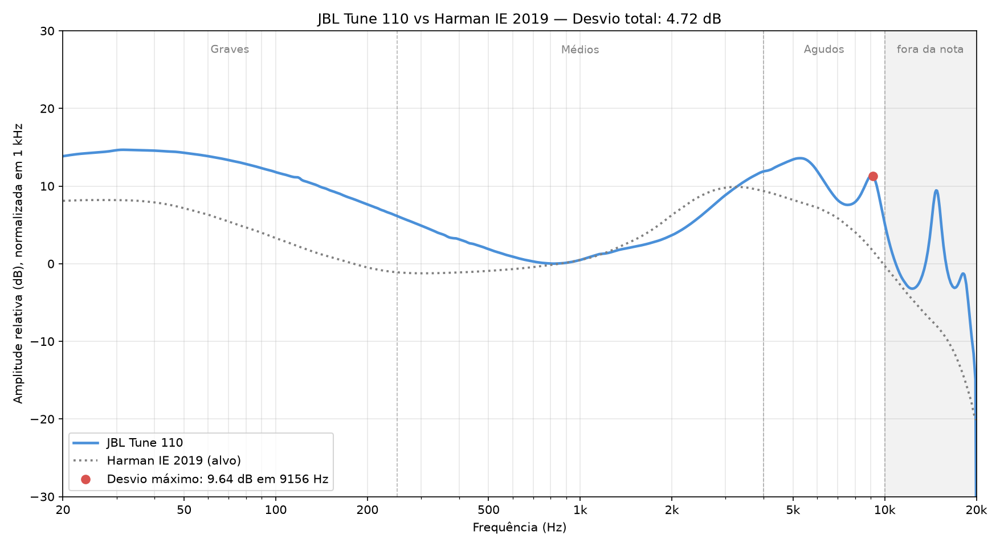

# JBL Tune 110

[← Voltar ao ranking](../README.md)

| Preço | Assinatura | Configuração medida |
| :---: | :---: | :--- |
| USD 15 | Baixudo | Única (cabo fixo, sem filtros ou chaves) |

## Resposta em frequência

## Avaliação do som

| Banda | Desvio médio | Nota |
| :--- | :---: | :---: |
| Graves | 7.52 dB | 1.00 |
| Médios | 2.16 dB | 3.34 |
| Agudos | 4.77 dB | 1.00 |
| **Média** | | **1.78** |

| Desvio total (20 Hz–10 kHz) | Desvio máximo | Frequência do desvio máximo |
| :---: | :---: | :---: |
| 4.72 dB | 9.64 dB | 9.16 kHz |

*Desvio total, desvio máximo e sua frequência são informativos e não entram nas notas. O desvio total não é utilizado para atribuir as notas de Graves, Médios ou Agudos.*

## Minhas medições

| Item | Medida |
| :--- | :--- |
| Massa por lado | 2 g |
| Maior diâmetro do bocal | 5.7 mm |
| Maior comprimento da carcaça | 12.0 mm |

*Medidos com balança e paquímetro digitais.*

## Avaliação do uso

| # | Grupo | Item | Critério atende? | Nota |
| :---: | :--- | :--- | :--- | :---: |
| 1 | Bocal | Bocal compatível (≤ 6.0 mm) | Diâmetro máximo de até 6.0 mm. | 1 |
| 2 | Conforto | Confortável após 60 minutos | Carcaça sem pressão, dor ou desconforto após 60 min. | 1 |
| 3 | Cabo | Flexível e sem microfonia | Flexível, desenrola fácil e sem ruídos na roupa. | 0 |
| 4 | Ponteiras | Silicone macio e flexível | Dobram ao meio facilmente com dois dedos. | 1 |
| 5 | Reparo | Troca de cabo | Cabo removível e com conexão fácil de encontrar. | 0 |
| **Soma** | | | | **3** |

**Extras (não entram na nota):** nenhum.

## Nota geral

| Graves | Médios | Agudos | Uso | **Geral** |
| :---: | :---: | :---: | :---: | :---: |
| 1.00 | 3.34 | 1.00 | 3.00 | **2.09** |

*Geral = (Graves + Médios + Agudos + Uso) ÷ 4. As quatro notas pesam o mesmo, 25% cada. Por isso o som (graves, médios e agudos) responde por 75% da nota e o uso por 25%.*

## Resumo

**Prós**

- ✅ Confortável no meu ouvido.
- ✅ Pequeno e leve.
- ✅ Fácil de achar pra comprar.

**Contras**

- ❌ Cabo com microfonia incômoda.
- ❌ Graves muito acima do alvo.
- ❌ Excesso de agudos.

## Especificações

| Item | Informação |
| :--- | :--- |
| Drivers | 9 mm |
| Quantidade por lado | 1 |
| Tecnologia | Dinâmico |
| Carcaça | Plástico |
| Conexão do cabo | Cabo não removível |
| Plug | 3.5 mm |
| Faixa de frequência | 20 Hz–20 kHz |
| Impedância | 16 Ω |
| Sensibilidade | 96 dB SPL |

## Como avalio

Confira [aqui](../README.md#como-avalio).
