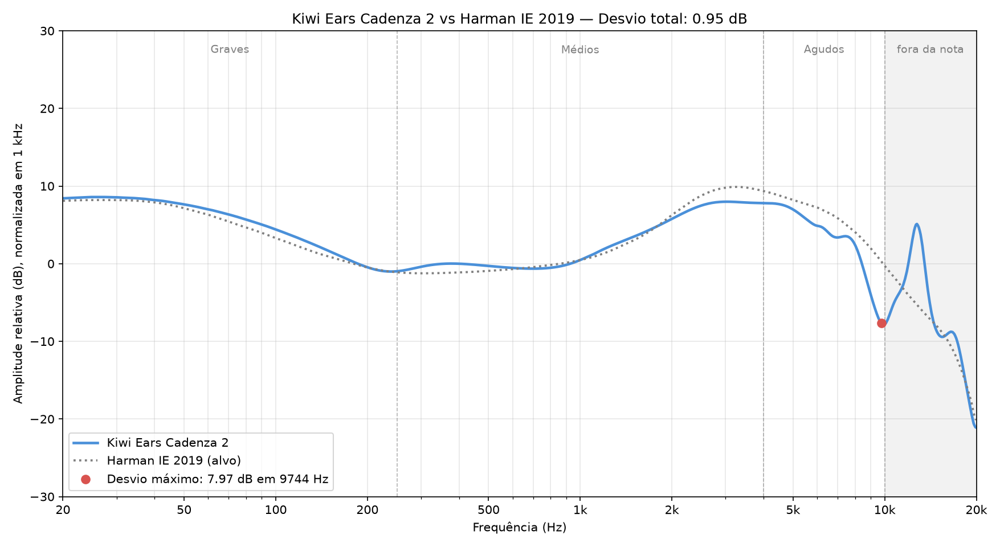

# Kiwi Ears Cadenza 2

[← Voltar ao ranking](../README.md)

| Preço | Assinatura | Configuração medida |
| :---: | :---: | :--- |
| USD 50 | Neutro | Única (sem filtros ou chaves) |

## Resposta em frequência

## Avaliação do som

| Banda | Desvio médio | Nota |
| :--- | :---: | :---: |
| Graves | 0.57 dB | 4.93 |
| Médios | 0.74 dB | 4.76 |
| Agudos | 2.64 dB | 2.86 |
| **Média** | | **4.18** |

| Desvio total (20 Hz–10 kHz) | Desvio máximo | Frequência do desvio máximo |
| :---: | :---: | :---: |
| 0.95 dB | 7.97 dB | 9.74 kHz |

*Desvio total, desvio máximo e sua frequência são informativos e não entram nas notas. O desvio total não é utilizado para atribuir as notas de Graves, Médios ou Agudos.*

## Minhas medições

| Item | Medida |
| :--- | :--- |
| Massa por lado | 4 g |
| Maior diâmetro do bocal | 5.9 mm |
| Maior comprimento da carcaça | 23.4 mm |

*Medidos com balança e paquímetro digitais.*

## Avaliação do uso

| # | Grupo | Item | Critério atende? | Nota |
| :---: | :--- | :--- | :--- | :---: |
| 1 | Bocal | Bocal compatível (≤ 6.0 mm) | Diâmetro máximo de até 6.0 mm. | 1 |
| 2 | Conforto | Confortável após 60 minutos | Carcaça sem pressão, dor ou desconforto após 60 min. | 0 |
| 3 | Cabo | Flexível e sem microfonia | Flexível, desenrola fácil e sem ruídos na roupa. | 1 |
| 4 | Ponteiras | Silicone macio e flexível | Dobram ao meio facilmente com dois dedos. | 1 |
| 5 | Reparo | Troca de cabo | Cabo removível e com conexão fácil de encontrar. | 1 |
| **Soma** | | | | **4** |

**Extras (não entram na nota):** ponteiras com opções de abertura estreita e larga.

## Nota geral

| Graves | Médios | Agudos | Uso | **Geral** |
| :---: | :---: | :---: | :---: | :---: |
| 4.93 | 4.76 | 2.86 | 4.00 | **4.14** |

*Geral = (Graves + Médios + Agudos + Uso) ÷ 4. As quatro notas pesam o mesmo, 25% cada. Por isso o som (graves, médios e agudos) responde por 75% da nota e o uso por 25%.*

## Resumo

**Prós**

- ✅ Bocal confortável no meu ouvido.
- ✅ Leve e bem acabado.
- ✅ Graves e médios próximos do alvo.

**Contras**

- ❌ Carcaça um pouco grande gerando leve desconforto após 60 min de uso.
- ❌ Cabo levemente grosso.
- ❌ Agudos recuados.

## Especificações

| Item | Informação |
| :--- | :--- |
| Drivers | 10 mm |
| Quantidade por lado | 1 |
| Tecnologia | Dinâmico com diafragma de PET revestido a titânio e sistema KARS 2.0 |
| Carcaça | Resina |
| Conexão do cabo | 0.78 mm, 2 pinos |
| Plug | 3.5 mm |
| Faixa de frequência | 10 Hz–29 kHz |
| Impedância | 18 Ω |
| Sensibilidade | 106 dB |

## Como avalio

Confira [aqui](../README.md#como-avalio).
