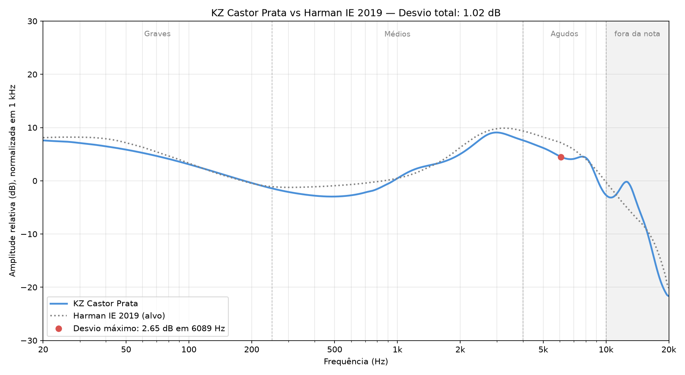

# KZ Castor

[← Voltar ao ranking](../README.md)

| Preço  | Assinatura | Configuração medida |
| :----: | :--------: | :------------------ |
| USD 15 |   Neutro   | Chaves em 1100      |

## Resposta em frequência

## Avaliação do som

| Banda | Desvio médio | Nota |
| :--- | :---: | :---: |
| Graves | 0.65 dB | 4.85 |
| Médios | 1.12 dB | 4.38 |
| Agudos | 1.73 dB | 3.77 |
| **Média** | | **4.33** |

| Desvio total (20 Hz–10 kHz) | Desvio máximo | Frequência do desvio máximo |
| :---: | :---: | :---: |
| 1.02 dB | 2.65 dB | 6.09 kHz |

*Desvio total, desvio máximo e sua frequência são informativos e não entram nas notas. O desvio total não é utilizado para atribuir as notas de Graves, Médios ou Agudos.*

## Minhas medições

| Item | Medida |
| :--- | :--- |
| Massa por lado | 8 g |
| Maior diâmetro do bocal | 6.0 mm |
| Maior comprimento da carcaça | 21.8 mm |

*Medidos com balança e paquímetro digitais.*

## Avaliação do uso

| # | Grupo | Item | Critério atende? | Nota |
| :---: | :--- | :--- | :--- | :---: |
| 1 | Bocal | Bocal compatível (≤ 6.0 mm) | Diâmetro máximo de até 6.0 mm. | 1 |
| 2 | Conforto | Confortável após 60 minutos | Carcaça sem pressão, dor ou desconforto após 60 min. | 0 |
| 3 | Cabo | Flexível e sem microfonia | Flexível, desenrola fácil e sem ruídos na roupa. | 0 |
| 4 | Ponteiras | Silicone macio e flexível | Dobram ao meio facilmente com dois dedos. | 0 |
| 5 | Reparo | Troca de cabo | Cabo removível e com conexão fácil de encontrar. | 1 |
| **Soma** | | | | **2** |

**Extras (não entram na nota):** chaves para ajustar a afinação.

## Nota geral

| Graves | Médios | Agudos | Uso | **Geral** |
| :---: | :---: | :---: | :---: | :---: |
| 4.85 | 4.38 | 3.77 | 2.00 | **3.75** |

*Geral = (Graves + Médios + Agudos + Uso) ÷ 4. As quatro notas pesam o mesmo, 25% cada. Por isso o som (graves, médios e agudos) responde por 75% da nota e o uso por 25%.*

## Resumo

**Prós**

- ✅ Resposta próxima do alvo nas três bandas.
- ✅ Carcaça confortável, sem pressionar a orelha.
- ✅ Bocal dentro do limite do meu canal auditivo.

**Contras**

- ❌ Cabo pouco flexível e com tendência a manter a memória depois de enrolado.
- ❌ As ponteiras não são macias.
- ❌ Leve incômodo após uso prolongado por causa do encaixe e ponteiras.

## Especificações

| Item | Informação |
| :--- | :--- |
| Drivers | 8 mm + 10 mm |
| Quantidade por lado | 2 |
| Tecnologia | Dinâmicos com diafragma composto e crossover eletrônico |
| Carcaça | Resina e metal |
| Conexão do cabo | 0.75 mm, 2 pinos, tipo C/QDC |
| Plug | 3.5 mm |
| Faixa de frequência | 20 Hz–40 kHz |
| Impedância | 31–35 Ω, conforme o ajuste das chaves |
| Sensibilidade | 105 dB |

## Como avalio

Confira [aqui](../README.md#como-avalio).
