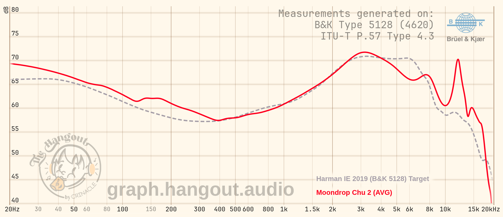

# Moondrop Chu II

[← Voltar ao ranking](../README.md)

| Preço  |  Assinatura   | Configuração medida           |
| :----: | :-----------: | :---------------------------- |
| USD 23 | Neutro quente | Única (sem filtros ou chaves) |

## Resposta em frequência

## Avaliação do som

| Banda | Desvio médio | Nota |
| :--- | :---: | :---: |
| Graves | ~2.15 dB | 3.35 |
| Médios | ~0.70 dB | 4.80 |
| Agudos | ~2.30 dB | 3.20 |
| **Média** | | **3.78** |

| Desvio total (20 Hz–10 kHz) | Desvio máximo | Frequência do desvio máximo |
| :---: | :---: | :---: |
| ~1.55 dB | ~4.50 dB | ~6.30 kHz |

*Desvio total, desvio máximo e sua frequência são informativos e não entram nas notas. O desvio total não é utilizado para atribuir as notas de Graves, Médios ou Agudos. Valores de desvio estimados visualmente a partir da curva de resposta em frequência.*

## Minhas medições

| Item                         | Medida  |
| :--------------------------- | :------ |
| Massa por lado               | 7 g     |
| Maior diâmetro do bocal      | 5.8 mm  |
| Maior comprimento da carcaça | 18.3 mm |

*Medidos com balança e paquímetro digitais.*

## Avaliação do uso

|    #     | Grupo     | Item                        | Critério atende?                                     | Nota  |
| :------: | :-------- | :-------------------------- | :--------------------------------------------------- | :---: |
|    1     | Bocal     | Bocal compatível (≤ 6.0 mm) | Diâmetro máximo de até 6.0 mm.                       |   1   |
|    2     | Conforto  | Confortável após 60 minutos | Carcaça sem pressão, dor ou desconforto após 60 min. |   1   |
|    3     | Cabo      | Flexível e sem microfonia   | Flexível, desenrola fácil e sem ruídos na roupa.     |   0   |
|    4     | Ponteiras | Silicone macio e flexível   | Dobram ao meio facilmente com dois dedos.            |   0   |
|    5     | Reparo    | Troca de cabo               | Cabo removível e com conexão fácil de encontrar.     |   1   |
| **Soma** |           |                             |                                                      | **3** |

**Extras (não entram na nota):** case de couro.

## Nota geral

| Graves | Médios | Agudos | Uso  | **Geral** |
| :----: | :----: | :----: | :--: | :-------: |
|  3.35  |  4.80  |  3.20  | 3.00 | **3.59**  |

*Geral = (Graves + Médios + Agudos + Uso) ÷ 4. As quatro notas pesam o mesmo, 25% cada. Por isso o som (graves, médios e agudos) responde por 75% da nota e o uso por 25%.*

## Resumo

**Prós**

- ✅ Médios e agudos muito próximos da minha preferência (Harman IE 2019). 
- ✅ Ótimo conforto pra minha orelha sem nenhum desconforto mesmo depois de horas de uso.
- ✅ Carcaça de liga de zinco muito bem acabada e bem pequena.

**Contras**

- ❌ Bocal pode oxidar com o tempo.
- ❌ Ponteiras não são macias.
- ❌ Cabo não tem ajustador e enrosca um pouco ao desenrolar.

## Especificações

| Item                | Informação                                                   |
| :------------------ | :----------------------------------------------------------- |
| Drivers             | 10 mm                                                        |
| Quantidade por lado | 1                                                            |
| Tecnologia          | Dinâmico com diafragma composto de liga de alumínio-magnésio |
| Carcaça             | Liga de zinco                                                |
| Conexão do cabo     | 0.78 mm, 2 pinos                                             |
| Plug                | 3.5 mm                                                       |
| Faixa de frequência | 15 Hz–38 kHz                                                 |
| Impedância          | 18 Ω                                                         |
| Sensibilidade       | 119 dB/Vrms                                                  |

## Como avalio

Confira [aqui](../README.md#como-avalio).
